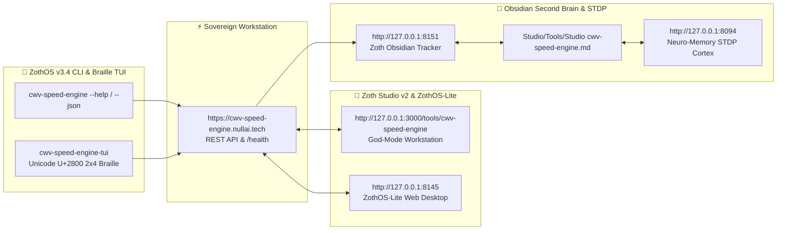

<div align="center">
  
</div>

<br />

# ⚡ CWV Speed Studio & Core Web Vitals Engine (`cwv-speed-engine`)

[](https://cwv-speed-studio.netlify.app/)
[](https://buy.stripe.com/3cIfZg27PdKo2D64Ocfw40X)
[](https://solana.fm/address/GG2eQbVh8ut1BK6j1A2tz7pSySdLpD38BgyEhGcxdXoK)
[](https://cwv-speed-studio.netlify.app/)
[](https://github.com/1nc0gn30/cwv-speed-engine/actions/workflows/ci.yml)
[](https://github.com/1nc0gn30/cwv-speed-engine)
[](https://modelcontextprotocol.io)

**CWV Speed Studio** (`cwv-speed-engine`) is an enterprise-grade Core Web Vitals auditing, automated speed transformation, PWA generation, and AI Agent MCP hub designed to help modern web applications achieve and maintain a perfect **100/100 Core Web Vitals score** (LCP < 1.2s, CLS 0, INP < 50ms). Runs 100% in-browser on client silicon with zero backend dependencies.

- 🌐 **Live Web App**: [https://cwv-speed-studio.netlify.app/](https://cwv-speed-studio.netlify.app/)
- ☕ **Support**: 100% Free & Open Access with optional [Buy Us a Coffee via Stripe](https://buy.stripe.com/3cIfZg27PdKo2D64Ocfw40X) and Solana Tip address: `GG2eQbVh8ut1BK6j1A2tz7pSySdLpD38BgyEhGcxdXoK`.
- ⚡ **Attribution**: Engineered by 1nc0gn30 • NullAI ([@1nc0gn30](https://github.com/1nc0gn30)) • NullAI Platform.

---

## 🌟 Key Capabilities

- 🎨 **CWV Speed Studio Web UI**: Full-featured, offline-ready web UI (design influenced by Material 3) with animated Speed Gauge Dial, metric cards, and 8 interactive studios.
- ⚡ **Deterministic Core Web Vitals Auditor**: In-depth standards-based analysis for LCP, CLS, INP, FCP, and TTFB with actionable remediation advice.
- 🛠️ **Automated HTML Speed Transformer**: Automated AST rewrites that inject explicit image dimensions, native lazy loading, font preconnects, script deferrals, and hero preload priority tags.
- 📱 **PWA & Service Worker Studio**: Interactive builder for W3C web manifests and tiered Service Worker caching strategies (`stale-while-revalidate`, `cache-first`, `network-first`).
- 🖼️ **OpenGraph & Social Previewer**: Live mockups for Google Search SERP, Twitter Cards, and LinkedIn snippets with 1-click meta tag copying.
- ⚖️ **Performance Diff Comparator**: Measure before vs after speed gains, metric deltas, and resolved audit findings.
- 🚀 **Cache-Control & Headers Exporter**: Instant production configs for Netlify, Vercel, Nginx, Cloudflare, Apache, and Next.js.
- 📊 **Performance Budget & Network Latency Simulator**: Enforce strict asset weight ceilings (Scripts, Styles, Fonts, Images), simulate real-world mobile 3G/4G/5G latency, calculate INP main-thread execution risks, and export standard Lighthouse `budget.json` for CI pipelines.
- 🤖 **AI Agent & MCP Hub**: Zero-dependency Model Context Protocol (MCP) server supporting Claude Desktop, Cursor, Cline, and Zed.
- 🚦 **CI/CD Quality Gate**: Reusable GitHub Actions workflow to block PRs regressing speed scores.
- 📦 **Zero Mandatory Dependencies**: Core engine and web server run purely on the Python standard library.

---

## 🚀 Quick Start

### Installation

```bash
# Clone the repository
git clone https://github.com/NullAITech/cwv-speed-engine.git
cd cwv-speed-engine

# Install in editable mode
pip install -e .
```

### Launch CWV Speed Studio Web UI

```bash
python -m cwv_speed_engine.ui_server --port 8448 --open
```

Open your browser to [http://localhost:8448](http://localhost:8448) to access the interactive studio.

---

## 💻 CLI Commands Cheatsheet

```bash
# 1. Audit a live URL
cwv-speed audit https://example.com --device mobile

# 2. Audit raw HTML markup
cwv-speed audit --html "<!DOCTYPE html>..."

# 3. Automatically transform HTML for maximum speed
cwv-speed optimize unoptimized.html -o index.html

# 4. Generate Progressive Web App Suite
cwv-speed pwa --name "My Speed App" --strategy stale-while-revalidate

# 5. Export Production Cache Headers
cwv-speed cache --platform netlify -o _headers

# 6. Audit Performance Budget & Multi-Network Latency
cwv-speed budget index.html --script-budget 150 --total-budget 500

# 7. Export Standard Lighthouse budget.json
cwv-speed budget index.html --lighthouse > budget.json

# 8. Run CI Gate on Pull Requests
cwv-speed ci-gate https://staging.example.com --min-score 90 --max-cls 0.05
```

---

## 🤖 AI Agent MCP Integration (Claude & Cursor)

`cwv-speed-engine` runs natively as an MCP server over stdio.

### Claude Desktop Setup
Add to `claude_desktop_config.json`:

```json
{
  "mcpServers": {
    "cwv-speed-engine": {
      "command": "python3",
      "args": ["-m", "cwv_speed_engine.mcp_server"],
      "env": {
        "PYTHONPATH": "src"
      }
    }
  }
}
```

### Cursor IDE Setup
Add to `.cursor/mcp.json`:

```json
{
  "mcp": {
    "servers": {
      "cwv-speed-engine": {
        "command": "python3",
        "args": ["-m", "cwv_speed_engine.mcp_server"],
        "env": {
          "PYTHONPATH": "src"
        }
      }
    }
  }
}
```

---

## 📂 Production Reference Examples

Explore production architecture blueprints in [`examples/`](./examples/):
- [`examples/nextjs-optimized/`](./examples/nextjs-optimized/): Next.js 14/15 App Router image optimization, font self-hosting, Early Hints edge middleware.
- [`examples/astro-speed/`](./examples/astro-speed/): Astro zero-JS Island architecture, `<SpeedHead />` component, sharp image processing.
- [`examples/pwa-manifest/`](./examples/pwa-manifest/): W3C PWA manifest, tiered `sw.js` caching, Material 3 offline page.
- [`examples/nginx-caching/`](./examples/nginx-caching/): Nginx configuration for sub-50ms TTFB and 1-year immutable caching.
- [`examples/mcp-clients/`](./examples/mcp-clients/): Ready-to-copy client configs for Claude, Cursor, Cline, and Zed.

---

## 📚 Documentation

- [Core Web Vitals Metric Guide (2024-2026 Standards)](./docs/CORE_WEB_VITALS_GUIDE.md)
- [Model Context Protocol (MCP) Guide](./docs/MCP_GUIDE.md)
- [High-Performance Caching & HTTP Headers Guide](./docs/CACHING_STRATEGIES.md)

---

## 🧪 Running Tests

```bash
PYTHONPATH=src pytest tests/ -v
```

---

## 📄 License

Apache License 2.0. See [LICENSE](./LICENSE) for details.

---

*Engineered with precision by 1nc0gn30 • NullAI ([@1nc0gn30](https://github.com/1nc0gn30)) • NullAI Platform ([nullai.tech](https://nullai.tech))*

---

## 🏛️ ZothOS v3.4, Zoth Studio v2 & Obsidian Second Brain Ecosystem



### Cross-Surface Integration Matrix

| Surface | Endpoint / Binary | Capabilities |
| :--- | :--- | :--- |
| **Standalone Workstation** | `https://cwv-speed-engine.nullai.tech` | 100% Free & Open-Access Web Deck, live `/health` & REST telemetry |
| **Zoth Studio v2 Route** | `http://127.0.0.1:3000/tools/cwv-speed-engine` | Interactive God-Mode component inside Zoth Studio (`https://zoth.nullai.tech`) |
| **ZothOS v3.4 CLI & TUI** | `cwv-speed-engine` / `cwv-speed-engine-tui` | Global binary in `/usr/local/bin/` with Unicode `U+2800` Braille TUI & `--json` output |
| **ZothOS-Lite Web Desktop** | `http://127.0.0.1:8145` | Browser-native KDE-style window manager & terminal launcher |
| **Zoth Obsidian Tracker** | `http://127.0.0.1:8151` | Interactive Obsidian Second Brain vault explorer (`~/Documents/Obsidian Vault/Studio/Tools/Studio cwv-speed-engine.md`) |
| **Neuro-Memory STDP Cortex** | `http://127.0.0.1:8094` | 3-Factor STDP synaptic memory daemon & 21-tool MCP server |

```bash
# Inspect CLI & Unicode U+2800 Braille TUI on ZothOS v3.4
cwv-speed-engine --help
cwv-speed-engine-tui --status
cwv-speed-engine-tui --json

# Verify Second Brain Vault & 12-Step Verification Gallery on :8151
zoth-obsidian-tracker --verify
```

