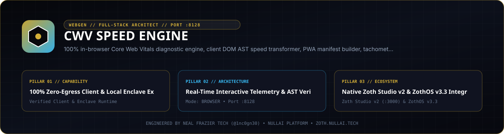

# CWV Speed Engine



Zero-dependency Core Web Vitals (LCP, INP, CLS, FCP, TTFB) diagnostic analyzer, HTML asset transformer, W3C Speculation Rules compiler, Long Animation Frames (LoAF) profiler, immutable cache header generator, performance budget simulator, and Model Context Protocol (MCP) server.

- **Local Workstation**: `http://127.0.0.1:8128`
- **Zoth Studio v2 Dossier**: [https://zoth.nullai.tech/tools/cwv-speed-engine](https://zoth.nullai.tech/tools/cwv-speed-engine)
- **Repository**: [https://github.com/1nc0gn30/cwv-speed-engine](https://github.com/1nc0gn30/cwv-speed-engine)

## Overview

CWV Speed Engine runs purely on the Python 3.8+ standard library (`html.parser`, `urllib`, `json`, `http.server`) and native browser DOM APIs with zero runtime dependencies. It statically and dynamically evaluates HTML documents and live URLs against Google Core Web Vitals thresholds (`LCP <= 2.5s`, `INP <= 200ms`, `CLS <= 0.1`), rewrites render-blocking markup, and generates edge caching and instant-navigation configurations.

Core capabilities:
- **Core Web Vitals Heuristic & Live Audit**: Detects render-blocking scripts and stylesheets, unoptimized hero images missing `fetchpriority="high"`, offscreen media missing `loading="lazy"`, layout-shift sources missing intrinsic `width`/`height`, and main-thread Long Animation Frames (LoAF) bottlenecks.
- **Deterministic HTML Speed Transformer**: Rewrites raw HTML to defer non-critical scripts, preload LCP candidates, add `decoding="async"` and `loading="lazy"` to below-the-fold media, and inline critical CSS.
- **W3C Speculation Rules & 103 Early Hints**: Generates `<script type="speculationrules">` JSON policies (`conservative`, `balanced`, `aggressive`) and HTTP `103 Early Hints` `Link` headers for zero-latency navigation prerendering.
- **Performance Budget & Throttling Simulator**: Audits script (`170 KB` default), stylesheet (`50 KB` default), and total payload budgets across simulated mobile/broadband RTT profiles and exports Lighthouse `budget.json` files.
- **Edge Cache, PWA & OpenGraph Compilers**: Synthesizes immutable `Cache-Control` rules for Netlify, Vercel, Nginx, Next.js, Cloudflare, and Apache alongside W3C `manifest.webmanifest`, `sw.js`, and OpenGraph/Twitter Card tags.

## Architecture

```text
cwv-speed-engine/
├── server.py                             # Standalone loopback workstation entrypoint (127.0.0.1:8128)
├── bin/
│   ├── cwv-speed.js                      # Unified CLI, Web UI, and Electron desktop launcher
│   └── cwv-speed-engine-tui              # Terminal dashboard launcher
├── public/                               # Zero-egress browser Speed Studio workstation
├── src/cwv_speed_engine/
│   ├── analyzer.py                       # LCP, INP, CLS, FCP, TTFB & DOM bottleneck analyzer
│   ├── loaf_analyzer.py                  # Long Animation Frames (LoAF) & INP script attribution
│   ├── transformer.py                    # AST/HTML loading-strategy optimizer
│   ├── speculation_engine.py             # W3C Speculation Rules & 103 Early Hints generator
│   ├── budget_simulator.py               # Payload budget & network latency simulator
│   ├── cache_rules.py                    # Netlify, Vercel, Nginx, Next.js, Cloudflare, Apache rules
│   ├── pwa_builder.py & og_builder.py    # Web manifest, ServiceWorker, and OpenGraph generators
│   ├── diff_engine.py & ci_gate.py       # Before/after score delta and CI/CD exit-code gate
│   ├── mcp_server.py                     # JSON-RPC 2.0 stdio MCP server (8 tools)
│   ├── ui_server.py                      # Threading HTTP REST API & Speed Studio server (:8128)
│   └── cli.py                            # cwv-engine / speed-engine CLI router
└── tests/                                # 175-test pytest verification suite
```

## Quickstart

```bash
git clone https://github.com/1nc0gn30/cwv-speed-engine.git
cd cwv-speed-engine
pip install -e .

# Launch the local Speed Studio UI and REST API on 127.0.0.1:8128
python3 server.py --port 8128
```

Open `http://127.0.0.1:8128` in any browser, or serve the client-side bundle directly:

```bash
python3 -m http.server 8128 --directory public
```

## CLI & MCP Usage

Installing via `pip install -e .` registers `cwv-engine`, `speed-engine`, and `cwv-mcp` (and ZothOS v3.4.0 exposes `cwv` / `cwv-speed` on `$PATH`).

```bash
# Check status and JSON telemetry
cwv-engine --help
cwv-engine --status
cwv-engine --json

# Audit a live URL or local HTML file and run the CI quality gate
cwv-engine audit https://example.com --device mobile --json
cwv-engine check ./public/index.html --min-score 85 --json

# Transform HTML loading attributes and defer blocking assets
cwv-engine optimize ./public/index.html --inline --json

# Generate W3C Speculation Rules and audit performance budgets
cwv-engine speculation ./public/index.html --aggressiveness balanced --format json
cwv-engine budget ./public/index.html --script-budget 170 --css-budget 50 --json

# Export immutable edge cache configs, PWA bundles, OpenGraph tags, and audit diffs
cwv-engine cache --framework netlify --days 365 --json
cwv-engine pwa --name "NullAI App" --theme-color "#0f172a" --json
cwv-engine og --title "NullAI App" --desc "Core Web Vitals workstation" --json
cwv-engine diff baseline.html optimized.html --json

# Launch the HTTP server on 127.0.0.1:8128
cwv-engine serve --host 127.0.0.1 --port 8128
```

### MCP Server Integration

Start the JSON-RPC 2.0 `stdio` MCP server or export client configurations for Claude Desktop, Cursor, Cline, or Zed:

```bash
cwv-engine mcp
cwv-engine mcp --tools
cwv-engine mcp --config claude
```

Registered MCP tools (8):
- `cwv_audit_site` — Audit a URL or HTML string for LCP, INP, CLS, FCP, and TTFB bottlenecks.
- `cwv_optimize_html` — Rewrite HTML with lazy-loading, hero prioritization, and deferred scripts.
- `cwv_generate_cache_config` — Generate immutable caching configs for Netlify, Vercel, Nginx, Next.js, Cloudflare, or Apache.
- `cwv_generate_pwa` — Compile W3C `manifest.webmanifest` and offline `sw.js`.
- `cwv_generate_og_card` — Generate OpenGraph and Twitter Card `<meta>` snippets.
- `cwv_diff_performance` — Compare baseline vs. candidate HTML/URL performance scores.
- `cwv_generate_speculation_rules` — Generate W3C Speculation Rules and `103 Early Hints` headers.
- `cwv_audit_performance_budget` — Evaluate asset payload budgets and export Lighthouse `budget.json`.

## REST API Endpoints

Bound by default to `http://127.0.0.1:8128`:

| Method | Endpoint | Description |
| :--- | :--- | :--- |
| `GET` | `/health`, `/api/health`, `/api/platform` | Service health and runtime diagnostics |
| `POST` | `/api/audit` | Run Core Web Vitals diagnostic audit on URL or HTML |
| `POST` | `/api/optimize`, `/api/transform` | Transform and optimize HTML asset loading strategies |
| `POST` | `/api/speculation` | Generate W3C Speculation Rules and `103 Early Hints` |
| `POST` | `/api/budget` | Run performance budget and network throttling simulation |
| `POST` | `/api/cache`, `/api/cache/export` | Generate edge server `Cache-Control` configurations |
| `POST` | `/api/pwa`, `/api/pwa/generate` | Generate web manifest and ServiceWorker assets |
| `POST` | `/api/og`, `/api/og/generate` | Generate OpenGraph and Twitter Card meta tags |
| `POST` | `/api/diff`, `/api/compare` | Compare two targets and compute score delta |
| `GET` | `/api/tools`, `/api/mcp/config` | List MCP tools and export client config JSON |
| `POST` | `/api/export-zip` | Download complete optimization bundle as a ZIP archive |

## Testing & Verification

```bash
# Run the 175-test pytest suite
PYTHONPATH=src python3 -m pytest -q

# Run built-in CLI verification suite
PYTHONPATH=src python3 -m cwv_speed_engine.cli --test

# Secret hygiene verification
gitleaks detect --source . --no-banner --redact
```

## Support

CWV Speed Engine is 100% free and open-source software with zero paywalls or feature gates. Optional support: [Buy Us a Coffee (Stripe)](https://buy.stripe.com/3cIfZg27PdKo2D64Ocfw40X).

## License

MIT License — Copyright (c) 1nc0gn30 ([https://1nc0gn30.si](https://1nc0gn30.si)) & NullAI ([https://nullai.tech](https://nullai.tech)).
